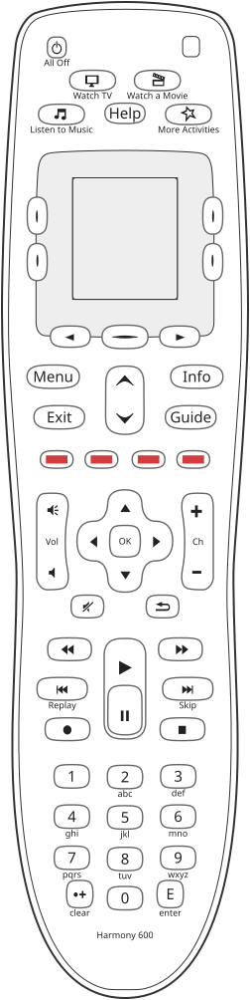

# Harmony 600: keys

The 600 has 54 keys. Most sit on the **keypad** and do what the running activity, or the device chosen in
device mode, says they do. The rest are keys **the screen speaks for**: the four beside the screen, the
three below it and the activity keys, whose meaning is whatever the current screen draws next to them.
The manual's button page names every key with the words printed on the remote, "The buttons on your
Harmony 600" on page 5[^x-manual].

**The 600's drawing is also the Harmony 650's and 700's.** The three share one face, one layout and one
form factor, [the architecture's README](../../architectures/harmony-600-650-700/README.md), so the 650
and 700 drawings take every shape and every scan code from this one and change only the nameplate.
[`reference/silhouettes/h600.svg`](../../silhouettes/h600.svg) is generated from
`packages/silhouettes/src/models/h600.ts`, traced from Logitech's own documentation of this model.

## Every key on the drawing

<!-- generated:keys -->
54 keys on the drawing `h600`, 42 on the keypad and 12 that the screen speaks for. 41 carry a scan code: 36 named through Logitech's button maps for a configuration compiled to a known setup[^s133]; 4 decided by the devices' own maps, since every activity gives both keys of a pair one command[^s323]; 1 bound by every activity Logitech compiles to that activity's own help[^s333].

| key | kind | name from | scan code | screen zone | printed on or beside it |
|---|---|---|---|---|---|
| `Menu` | keypad | catalogue | 10 (0x0A)[^s133] |  | Menu |
| `Exit` | keypad | catalogue | 12 (0x0C)[^s133] |  | Exit |
| `Red` | keypad | catalogue | 13 (0x0D)[^s133] |  |  |
| `VolumeUp` | keypad | catalogue | 14 (0x0E)[^s133] |  |  |
| `VolumeDown` | keypad | catalogue | 15 (0x0F)[^s133] |  |  |
| `VolumeMute` | keypad | catalogue | 16 (0x10)[^s133] |  |  |
| `Number4` | keypad | catalogue | 17 (0x11)[^s133] |  | 4, ghi |
| `Number7` | keypad | catalogue | 18 (0x12)[^s133] |  | 7, pqrs |
| `NumberPlus` | keypad | catalogue | 19 (0x13)[^s133] |  | clear |
| `Number0` | keypad | catalogue | 20 (0x14)[^s133] |  | 0 |
| `SkipBack` | keypad | catalogue | 21 (0x15)[^s133] |  | Replay |
| `Rewind` | keypad | catalogue | 22 (0x16)[^s133] |  |  |
| `Record` | keypad | catalogue | 23 (0x17)[^s133] |  |  |
| `Number1` | keypad | catalogue | 24 (0x18)[^s133] |  | 1 |
| `UpArrow` | keypad | catalogue | 26 (0x1A)[^s323] |  |  |
| `DownArrow` | keypad | catalogue | 27 (0x1B)[^s323] |  |  |
| `Yellow` | keypad | catalogue | 28 (0x1C)[^s133] |  |  |
| `Blue` | keypad | catalogue | 29 (0x1D)[^s133] |  |  |
| `FastForward` | keypad | catalogue | 30 (0x1E)[^s133] |  |  |
| `ChannelUp` | keypad | catalogue | 31 (0x1F)[^s133] |  |  |
| `ChannelDown` | keypad | catalogue | 32 (0x20)[^s133] |  |  |
| `Guide` | keypad | catalogue | 33 (0x21)[^s133] |  | Guide |
| `Info` | keypad | catalogue | 36 (0x24)[^s133] |  | Info |
| `Number6` | keypad | catalogue | 37 (0x25)[^s133] |  | 6, mno |
| `SkipForward` | keypad | catalogue | 38 (0x26)[^s133] |  | Skip |
| `Number3` | keypad | catalogue | 39 (0x27)[^s133] |  | 3, def |
| `Stop` | keypad | catalogue | 40 (0x28)[^s133] |  |  |
| `DirectionRight` | keypad | catalogue | 41 (0x29)[^s133] |  |  |
| `DirectionDown` | keypad | catalogue | 42 (0x2A)[^s323] |  |  |
| `PrevChannel` | keypad | catalogue | 43 (0x2B)[^s133] |  |  |
| `Play` | keypad | catalogue | 44 (0x2C)[^s133] |  |  |
| `Number9` | keypad | catalogue | 45 (0x2D)[^s133] |  | 9, wxyz |
| `Pause` | keypad | catalogue | 46 (0x2E)[^s133] |  |  |
| `Number2` | keypad | catalogue | 47 (0x2F)[^s133] |  | 2, abc |
| `Number5` | keypad | catalogue | 48 (0x30)[^s133] |  | 5, jkl |
| `Green` | keypad | catalogue | 49 (0x31)[^s133] |  |  |
| `DirectionUp` | keypad | catalogue | 50 (0x32)[^s323] |  |  |
| `Select` | keypad | catalogue | 51 (0x33)[^s133] |  | OK |
| `DirectionLeft` | keypad | catalogue | 52 (0x34)[^s133] |  |  |
| `Number8` | keypad | catalogue | 53 (0x35)[^s133] |  | 8, tuv |
| `AllOff` | keypad | printed | not measured |  | All Off |
| `Enter` | keypad | printed | not measured |  | E, enter |
| `Help` | screen | printed | 3 (0x03)[^s333] |  | Help |
| `ListenToMusic` | screen | printed | not measured |  | Listen to Music |
| `MoreActivities` | screen | printed | not measured |  | More Activities |
| `ScreenLowerLeft` | screen | printed | not measured | 3 |  |
| `ScreenLowerRight` | screen | printed | not measured | 4 |  |
| `ScreenNext` | screen | printed | not measured |  |  |
| `ScreenPrev` | screen | printed | not measured |  |  |
| `ScreenSelect` | screen | printed | not measured | 5 |  |
| `ScreenUpperLeft` | screen | printed | not measured | 1 |  |
| `ScreenUpperRight` | screen | printed | not measured | 2 |  |
| `WatchAMovie` | screen | printed | not measured |  | Watch a Movie |
| `WatchTV` | screen | printed | not measured |  | Watch TV |

Generated from `packages/silhouettes/src/models/h600.ts` by `make remote-reference-write`. Change the source, not this block.
<!-- /generated -->

## Where the scan codes come from

A scan code is the number the remote gives a key internally; a configuration binds commands to scan codes.
**The scan codes on the drawing were measured on the 600**, and the table above footnotes each with where
it came from. 36 were named through a configuration generated for this model by Logitech's own service:
each code a key sends was decoded and looked up in that service's named commands and button maps for the
same configuration[^s133]. Logitech's maps name 40 buttons, those 36 and the four up and down keys, with
none left over in either direction[^s145].

**The four up and down keys are decided by the devices' own maps.** Every activity gives the two up keys
one command and the two down keys another, so no activity tells them apart[^s133]. The devices' own maps
state `DirectionUp` and `DirectionDown` and no arrows, and each device's own record binds 50 and 42 and
leaves 26 and 27 unbound, so 26 is `UpArrow`, 27 `DownArrow`, 50 `DirectionUp` and 42
`DirectionDown`[^s323].

**Help is scan 3**: every activity Logitech compiles for this architecture binds Help's release there, to
that activity's own help, and no device's map binds it[^s333].

So the 650 and 700 carry the 600's numbers.

**There are 54**, and three routes agree: the key table's split of a key code into an event and a
scan[^s17]; the keys pressed one by one on a unit, which fall into the four columns of the keypad matrix
as 14, 14, 13 and 13[^t-keypad]; and the drawing. The keypad scanner is a matrix of 14 rows by 4 columns,
found in the Harmony 700's 2.8 image[^s13], the same architecture, and it returns `(row - 1) * 4 + column`
with the row counted from one, so the codes run from 1 to 56[^s17b]; no 600 has been opened to check the
board[^unchecked].

## The two populations

A key is either on the **keypad**, bound by the activity and device maps, or one **the screen speaks
for**. On this architecture the two share no scan code[^s128]. The manual: "The arrow buttons below the
screen allow you to move through various options on the remote screen. The center button below the
remote screen and the side buttons beside the screen let you choose those options."[^x-manual]

**The labels of the side keys sit in two rows**, at pixel rows 35 and 79 with a line pitch of 14: the
top row belongs to keys 2 and 8, left then right, and the bottom row to 9 and 34[^s128]. Which side is
which comes from behaviour, since every label whose activity is known is drawn centred: the help screens draw
"No" at x 5 and "Yes" at x 97, and scan 9's action list differs from one help screen to the next while
scan 34's is identical on all of them, which is what a retry and a finish look like[^s128]. Measured over
the configurations of this architecture, so the Harmony 650 and 700, which share the face, place their
labels the same way[^s128].

## What the drawing does not yet carry

| key | the measurement | evidence |
|---|---|---|
| the four screen corners and the centre key below the screen | 8, 2, 9 and 34 for the corners, 25 for the centre key | [^s285], [^s311] |
| Watch TV, Watch a Movie, Listen to Music | 5, 1 and 7; Listen to Music by elimination | [^s314] |
| More Activities | 4, **not measured** | [^s314] |

The drawing calls the activity keys and Help `screen` keys, which is a statement about the drawing's
layers; in the configuration they are hard keys bound by the key map that is always installed[^s314].

## What pressing a key raises

Three events per key, press, release and repeat: the event in the top two bits of a key code and the
scan code in the low six[^s17]. The firmware's own reading of them, and that it tells no long press from
a short one, was read on the Harmony 650's 0.2 build[^s340]; the 600's 0.2 build is the same program in
another build, [firmware.md](firmware.md), and its key handler is **not read** separately[^unchecked].

**Mode 0**, the screen an activity key with no activity opens, binds every scan code from 1 to 54 and
swallows all but the centre key, which returns[^s311].

## Not checked

* The scan codes of the two arrows below the screen, All Off, Enter and More Activities[^unchecked].
* The key handler on the 600's own 0.2 build[^unchecked].
* Whether a skin 73 unit's keypad differs in its printing. The 600's and 700's safe mode configurations
  differ in 83 bytes, almost all in the key table, and nothing has read why[^s24].

[^x-manual]: Stated by Logitech, in the manual. [The Harmony 600 user manual](https://www.manualslib.com/manual/634914/Logitech-Harmony-600.html)
[^s133]: Measured in configurations. [Section 133](../../../docs/findings.md#s133)
[^s145]: Stated by Logitech, by their service. [Section 145](../../../docs/findings.md#s145)
[^s17]: Measured in configurations. [Section 17](../../../docs/findings.md#s17)
[^t-keypad]: Measured on a unit. [The test](../../../tests/test_keypad.py)
[^s13]: Read in the firmware. [Section 13](../../../docs/findings.md#s13)
[^s17b]: Read in the firmware. [Section 17](../../../docs/findings.md#s17)
[^unchecked]: Not checked.
[^s128]: Measured in configurations. [Section 128](../../../docs/findings.md#s128)
[^s323]: Measured in configurations. [Section 323](../../../docs/findings.md#s323)
[^s333]: Measured in configurations. [Section 333](../../../docs/findings.md#s333)
[^s285]: Measured in configurations. [Section 285](../../../docs/findings.md#s285)
[^s311]: Measured in configurations. [Section 311](../../../docs/findings.md#s311)
[^s314]: Measured in configurations. [Section 314](../../../docs/findings.md#s314)
[^s340]: Read in the firmware. [Section 340](../../../docs/findings.md#s340)
[^s24]: Measured on a unit. [Section 24](../../../docs/findings.md#s24)
