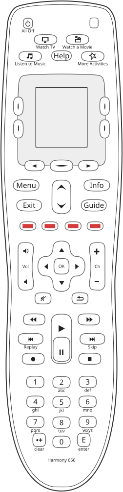

# Harmony 650: keys

**The Harmony 650 has the Harmony 600's face**, key for key: the 600, 650 and 700 share one layout and
one form factor, and the only difference on the face is the model number at the bottom[^unchecked]. The
650's manual draws the same keys with the same printed words on its page 2, which agrees and is not a
measurement of the case[^x-manual]. So its drawing,
[`reference/silhouettes/h650.svg`](../../silhouettes/h650.svg), is generated from
`packages/silhouettes/src/models/h650.ts`, which takes every shape and scan code from the 600's model by
reference and changes only the nameplate. Whether the 650's case differs in colour or finish does not
matter to the drawing and is not checked[^unchecked].

## The two populations

A key is either on the **keypad**, bound by the activity and device maps, or one **the screen speaks
for**, whose meaning is whatever the current page draws beside it. On this architecture the two share
no scan code at all[^s128]. The screen keys are the four flanking the display and the three below it:

| screen key | scan | what it does | evidence |
|---|---|---|---|
| upper left of the display | 8 | the item drawn beside it | [^s285] |
| upper right | 2 | the same | [^s285] |
| lower left | 9 | the same | [^s285] |
| lower right | 34 | the same | [^s285] |
| centre key below the display | 25 | "Devices" on an activity's screens, "Activity" or "Activities" on a device list, "Exit" in mode 0; the words also seen on a 650's screen | [^s290], [^s294], [^s311]; seen [^s285b], [^s294b] |
| left and right arrows below the display | **not measured** | turn the page of a list | [^x-manual]; the scan codes [^unchecked] |

The 650's manual: "The arrow buttons help you move through each page of options, while the side buttons
allow you to choose an option. The center button lets you switch between Activities and devices, or
return to the devices list."[^x-manual]

## Every key on the drawing

The drawing's own list, generated. A scan code appears only where the drawing names it, and the drawing
took them from the **Harmony 600's** calibration configuration, where each was decoded from the code it
sends[^s133]. On the 650 the same codes are carried over on the strength of the shared face; the 650's
own button map has **not** been measured[^unchecked]. What does hold on the 650 is that its mode 0 lists
every scan from 1 to 54, so it has the same 54 codes[^s311].

<!-- generated:keys -->
54 keys on the drawing `h650`, 42 on the keypad and 12 that the screen speaks for. 36 carry a measured scan code and 4 are left between two candidates by the drawing.

| key | kind | name from | scan code | screen zone | printed on or beside it |
|---|---|---|---|---|---|
| `Menu` | keypad | catalogue | 10 (0x0A) |  | Menu |
| `Exit` | keypad | catalogue | 12 (0x0C) |  | Exit |
| `Red` | keypad | catalogue | 13 (0x0D) |  |  |
| `VolumeUp` | keypad | catalogue | 14 (0x0E) |  |  |
| `VolumeDown` | keypad | catalogue | 15 (0x0F) |  |  |
| `VolumeMute` | keypad | catalogue | 16 (0x10) |  |  |
| `Number4` | keypad | catalogue | 17 (0x11) |  | 4, ghi |
| `Number7` | keypad | catalogue | 18 (0x12) |  | 7, pqrs |
| `NumberPlus` | keypad | catalogue | 19 (0x13) |  | clear |
| `Number0` | keypad | catalogue | 20 (0x14) |  | 0 |
| `SkipBack` | keypad | catalogue | 21 (0x15) |  | Replay |
| `Rewind` | keypad | catalogue | 22 (0x16) |  |  |
| `Record` | keypad | catalogue | 23 (0x17) |  |  |
| `Number1` | keypad | catalogue | 24 (0x18) |  | 1 |
| `Yellow` | keypad | catalogue | 28 (0x1C) |  |  |
| `Blue` | keypad | catalogue | 29 (0x1D) |  |  |
| `FastForward` | keypad | catalogue | 30 (0x1E) |  |  |
| `ChannelUp` | keypad | catalogue | 31 (0x1F) |  |  |
| `ChannelDown` | keypad | catalogue | 32 (0x20) |  |  |
| `Guide` | keypad | catalogue | 33 (0x21) |  | Guide |
| `Info` | keypad | catalogue | 36 (0x24) |  | Info |
| `Number6` | keypad | catalogue | 37 (0x25) |  | 6, mno |
| `SkipForward` | keypad | catalogue | 38 (0x26) |  | Skip |
| `Number3` | keypad | catalogue | 39 (0x27) |  | 3, def |
| `Stop` | keypad | catalogue | 40 (0x28) |  |  |
| `DirectionRight` | keypad | catalogue | 41 (0x29) |  |  |
| `PrevChannel` | keypad | catalogue | 43 (0x2B) |  |  |
| `Play` | keypad | catalogue | 44 (0x2C) |  |  |
| `Number9` | keypad | catalogue | 45 (0x2D) |  | 9, wxyz |
| `Pause` | keypad | catalogue | 46 (0x2E) |  |  |
| `Number2` | keypad | catalogue | 47 (0x2F) |  | 2, abc |
| `Number5` | keypad | catalogue | 48 (0x30) |  | 5, jkl |
| `Green` | keypad | catalogue | 49 (0x31) |  |  |
| `Select` | keypad | catalogue | 51 (0x33) |  | OK |
| `DirectionLeft` | keypad | catalogue | 52 (0x34) |  |  |
| `Number8` | keypad | catalogue | 53 (0x35) |  | 8, tuv |
| `AllOff` | keypad | printed | not measured |  | All Off |
| `DirectionDown` | keypad | catalogue | one of 27 or 42 |  |  |
| `DirectionUp` | keypad | catalogue | one of 26 or 50 |  |  |
| `DownArrow` | keypad | catalogue | one of 27 or 42 |  |  |
| `Enter` | keypad | printed | not measured |  | E, enter |
| `UpArrow` | keypad | catalogue | one of 26 or 50 |  |  |
| `Help` | screen | printed | not measured |  | Help |
| `ListenToMusic` | screen | printed | not measured |  | Listen to Music |
| `MoreActivities` | screen | printed | not measured |  | More Activities |
| `ScreenLowerLeft` | screen | printed | not measured | 3 |  |
| `ScreenLowerRight` | screen | printed | not measured | 4 |  |
| `ScreenNext` | screen | printed | not measured |  |  |
| `ScreenPrev` | screen | printed | not measured |  |  |
| `ScreenSelect` | screen | printed | not measured | 5 |  |
| `ScreenUpperLeft` | screen | printed | not measured | 1 |  |
| `ScreenUpperRight` | screen | printed | not measured | 2 |  |
| `WatchAMovie` | screen | printed | not measured |  | Watch a Movie |
| `WatchTV` | screen | printed | not measured |  | Watch TV |

Generated from `packages/silhouettes/src/models/h650.ts` by `make remote-reference-write`. Change the source, not this block.
<!-- /generated -->

## What the drawing does not yet carry

These are measured elsewhere and the drawing has not caught up. The drawing is the source of the table
above, so the fix belongs there and not in this file.

| key | the measurement | evidence |
|---|---|---|
| the four up and down keys | 26 is `UpArrow`, 27 `DownArrow`, 50 `DirectionUp`, 42 `DirectionDown`, from the device maps of the Harmony 600's calibration configuration. The drawing still leaves each between two candidates | [^s323] |
| the four screen corners and the centre key | 8, 2, 9, 34 and 25, above | [^s285], [^s311] |
| Help | 3: every activity Logitech compiles binds Help's release on scan 3, and the firmware gives scan 3 a repeat timer of its own, below | [^s333], [^s340] |
| Watch TV, Watch a Movie, Listen to Music | 5, 1 and 7, read from thirteen Logitech compiles including two of the 650's; Listen to Music by elimination | [^s314] |
| More Activities | 4, **not measured on the 650**. On the Harmony 700, which has this face, pressing More Activities ran what the activity menu binds to scan 4; on a 650 the press did nothing on a file binding scan 4 back to the menu, as that file predicts | [^s314]; the 700 [^s383]; the 650 [^s374] |

The drawing calls the activity keys and Help `screen` keys, which is a statement about the drawing's
layers. In the configuration they are hard keys bound by the always installed key map, not keys the
screen speaks for[^s314].

**Which activity each activity key starts** is chosen in MyHarmony's "Customize Activity Buttons" screen,
a list of the activities per key with no empty choice, and saved as a button map of its own rather than
as part of an activity: an activity's type does not move it[^s340b]. So with three activities or more
all three keys hold one, and Listen to Music is empty only where there are two, over fifteen compiles of
this architecture[^s340c].

## What pressing a key raises

A key raises three events and no others, read in the 650's 0.2 firmware[^s340]:

| event | when |
|---|---|
| press | the key goes down |
| repeat | the key is still down when a timer started at the press runs out |
| release | the key is let go |

**There is no long press.** Nothing in the firmware tells a short press from a long one, so a long press
action could only be imitated by a configuration binding a key's repeat, and Logitech's compiler binds the
activity keys' press alone[^s340]. Logitech's service agrees and declares no long press for this model,
[the architecture's README](../../architectures/harmony-600-650-700/README.md). MyHarmony's client offers
a long press activity per activity key, which belongs to later models[^s340b].

**Help waits longer.** The repeat timer is one value for every key and another for Help, starting at 10
and 50, each multiplied by 100 before the timer starts, so Help waits five times longer before its
repeat[^s340]. The timer's unit and whether the repeat keeps firing while the key is held are not
read[^unchecked].

## Keys on the firmware's own screens

The placeholders and "USB Connected" bind the keypad in a way of their own, the same on all three
models: [the architecture's misc.md](../../architectures/harmony-600-650-700/misc.md). On the 650's
drawing the keys "USB Connected" waits for, scans 11, 12 and 51, are an unnamed key, Exit and OK[^s357].

## Keys with no code at all

* **All Off** carries no measured scan code here[^unchecked]. It sends the activity's off sequence, per
  the manual[^x-manual]. In the device mode of a Panasonic television whose power commands Logitech's
  compile bound to screen keys only, the keypad's power key did nothing on a 650[^s306]; **All Off is
  the only key on the drawing that can be meant**, which is this reference's reading and is not
  checked[^unchecked].
* **No Devices key.** Device mode is the centre key below the display, under the word "Devices"; see
  [behaviour.md](behaviour.md).

## Not checked

* The 650's own button map: every scan code on the drawing is the 600's, carried over[^unchecked].
* The scan codes of the two arrows below the display, All Off, Enter and More Activities[^unchecked].
* The repeat timer's unit, and whether repeat fires once or keeps firing[^unchecked].

[^unchecked]: Not checked.
[^x-manual]: Stated by Logitech, in the manual. [The Harmony 650 user manual](https://www.logitech.com/assets/44635/3/harmony650-user-guide.pdf)
[^s128]: Measured in configurations. [Section 128](../../../docs/findings.md#s128)
[^s285]: Measured in configurations. [Section 285](../../../docs/findings.md#s285)
[^s290]: Measured in configurations. [Section 290](../../../docs/findings.md#s290)
[^s294]: Measured in configurations. [Section 294](../../../docs/findings.md#s294)
[^s311]: Measured in configurations. [Section 311](../../../docs/findings.md#s311)
[^s285b]: Measured on a unit. [Section 285](../../../docs/findings.md#s285)
[^s294b]: Measured on a unit. [Section 294](../../../docs/findings.md#s294)
[^s133]: Measured in configurations. [Section 133](../../../docs/findings.md#s133)
[^s323]: Measured in configurations. [Section 323](../../../docs/findings.md#s323)
[^s333]: Measured in configurations. [Section 333](../../../docs/findings.md#s333)
[^s340]: Read in the firmware. [Section 340](../../../docs/findings.md#s340)
[^s314]: Measured in configurations. [Section 314](../../../docs/findings.md#s314)
[^s383]: Measured on a unit. [Section 383](../../../docs/findings.md#s383)
[^s374]: Measured on a unit. [Section 374](../../../docs/findings.md#s374)
[^s340b]: Stated by Logitech, in their client. [Section 340](../../../docs/findings.md#s340)
[^s340c]: Measured in configurations. [Section 340](../../../docs/findings.md#s340)
[^s357]: Measured in configurations. [Section 357](../../../docs/findings.md#s357)
[^s306]: Measured on a unit. [Section 306](../../../docs/findings.md#s306)
