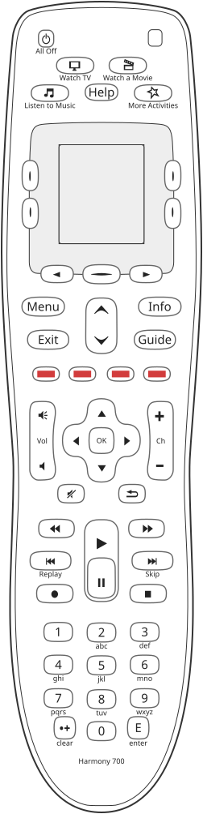

# Harmony 700: keys

**The Harmony 700 has the Harmony 600's face**, key for key: the 600, 650 and 700 share one layout and
one form factor, and the only difference on the face is the model number at the bottom. The 700's manual
draws the same keys under "The buttons on your Harmony 700", page 5[^x-manual]. So its drawing,
[`reference/silhouettes/h700.svg`](../../silhouettes/h700.svg), is generated from
`packages/silhouettes/src/models/h700.ts`, which takes every shape and scan code from the 600's model by
reference and changes only the nameplate.

## Where the scan codes come from

Every scan code on the drawing was **measured on the Harmony 600**[^s133], and is carried over on the
strength of the shared face; the 700's own button map has **not** been measured[^unchecked]. What holds
on the 700 itself: its mode 0 lists the 600's 162 key events in the 600's order, so it has the same 54
scans[^s311]; and the keypad scanner, a 14 by 4 matrix returning `row * 4 + column`, was first read in
the 700's 2.8 image[^s13].

The screen keys, 8, 2, 9 and 34 for the corners and 25 for the centre key, are read from configurations
including the 700's[^s285][^s311]; the Harmony 650's [keys.md](../harmony-650/keys.md) has the table. The
activity keys, scans 5, 1 and 7, are one entry each in a key map that is always installed, read from
Logitech's compiles including four of the 700's[^s314].

## Every key on the drawing

<!-- generated:keys -->
54 keys on the drawing `h700`, 42 on the keypad and 12 that the screen speaks for. 41 carry a scan code: 36 named through Logitech's button maps for a configuration compiled to a known setup[^s133]; 4 decided by the devices' own maps, since every activity gives both keys of a pair one command[^s323]; 1 bound by every activity Logitech compiles to that activity's own help[^s333].

| key | kind | name from | scan code | screen zone | printed on or beside it |
|---|---|---|---|---|---|
| `Menu` | keypad | catalogue | 10 (0x0A)[^s133] |  | Menu |
| `Exit` | keypad | catalogue | 12 (0x0C)[^s133] |  | Exit |
| `Red` | keypad | catalogue | 13 (0x0D)[^s133] |  |  |
| `VolumeUp` | keypad | catalogue | 14 (0x0E)[^s133] |  |  |
| `VolumeDown` | keypad | catalogue | 15 (0x0F)[^s133] |  |  |
| `VolumeMute` | keypad | catalogue | 16 (0x10)[^s133] |  |  |
| `Number4` | keypad | catalogue | 17 (0x11)[^s133] |  | 4, ghi |
| `Number7` | keypad | catalogue | 18 (0x12)[^s133] |  | 7, pqrs |
| `NumberPlus` | keypad | catalogue | 19 (0x13)[^s133] |  | clear |
| `Number0` | keypad | catalogue | 20 (0x14)[^s133] |  | 0 |
| `SkipBack` | keypad | catalogue | 21 (0x15)[^s133] |  | Replay |
| `Rewind` | keypad | catalogue | 22 (0x16)[^s133] |  |  |
| `Record` | keypad | catalogue | 23 (0x17)[^s133] |  |  |
| `Number1` | keypad | catalogue | 24 (0x18)[^s133] |  | 1 |
| `UpArrow` | keypad | catalogue | 26 (0x1A)[^s323] |  |  |
| `DownArrow` | keypad | catalogue | 27 (0x1B)[^s323] |  |  |
| `Yellow` | keypad | catalogue | 28 (0x1C)[^s133] |  |  |
| `Blue` | keypad | catalogue | 29 (0x1D)[^s133] |  |  |
| `FastForward` | keypad | catalogue | 30 (0x1E)[^s133] |  |  |
| `ChannelUp` | keypad | catalogue | 31 (0x1F)[^s133] |  |  |
| `ChannelDown` | keypad | catalogue | 32 (0x20)[^s133] |  |  |
| `Guide` | keypad | catalogue | 33 (0x21)[^s133] |  | Guide |
| `Info` | keypad | catalogue | 36 (0x24)[^s133] |  | Info |
| `Number6` | keypad | catalogue | 37 (0x25)[^s133] |  | 6, mno |
| `SkipForward` | keypad | catalogue | 38 (0x26)[^s133] |  | Skip |
| `Number3` | keypad | catalogue | 39 (0x27)[^s133] |  | 3, def |
| `Stop` | keypad | catalogue | 40 (0x28)[^s133] |  |  |
| `DirectionRight` | keypad | catalogue | 41 (0x29)[^s133] |  |  |
| `DirectionDown` | keypad | catalogue | 42 (0x2A)[^s323] |  |  |
| `PrevChannel` | keypad | catalogue | 43 (0x2B)[^s133] |  |  |
| `Play` | keypad | catalogue | 44 (0x2C)[^s133] |  |  |
| `Number9` | keypad | catalogue | 45 (0x2D)[^s133] |  | 9, wxyz |
| `Pause` | keypad | catalogue | 46 (0x2E)[^s133] |  |  |
| `Number2` | keypad | catalogue | 47 (0x2F)[^s133] |  | 2, abc |
| `Number5` | keypad | catalogue | 48 (0x30)[^s133] |  | 5, jkl |
| `Green` | keypad | catalogue | 49 (0x31)[^s133] |  |  |
| `DirectionUp` | keypad | catalogue | 50 (0x32)[^s323] |  |  |
| `Select` | keypad | catalogue | 51 (0x33)[^s133] |  | OK |
| `DirectionLeft` | keypad | catalogue | 52 (0x34)[^s133] |  |  |
| `Number8` | keypad | catalogue | 53 (0x35)[^s133] |  | 8, tuv |
| `AllOff` | keypad | printed | not measured |  | All Off |
| `Enter` | keypad | printed | not measured |  | E, enter |
| `Help` | screen | printed | 3 (0x03)[^s333] |  | Help |
| `ListenToMusic` | screen | printed | not measured |  | Listen to Music |
| `MoreActivities` | screen | printed | not measured |  | More Activities |
| `ScreenLowerLeft` | screen | printed | not measured | 3 |  |
| `ScreenLowerRight` | screen | printed | not measured | 4 |  |
| `ScreenNext` | screen | printed | not measured |  |  |
| `ScreenPrev` | screen | printed | not measured |  |  |
| `ScreenSelect` | screen | printed | not measured | 5 |  |
| `ScreenUpperLeft` | screen | printed | not measured | 1 |  |
| `ScreenUpperRight` | screen | printed | not measured | 2 |  |
| `WatchAMovie` | screen | printed | not measured |  | Watch a Movie |
| `WatchTV` | screen | printed | not measured |  | Watch TV |

Generated from `packages/silhouettes/src/models/h700.ts` by `make remote-reference-write`. Change the source, not this block.
<!-- /generated -->

## What the drawing does not yet carry

The same as the 600's, [keys.md](../harmony-600/keys.md): the four screen corners, the centre key below
the screen and the activity keys are measured and not yet on the drawing[^s285][^s314], and More
Activities' scan 4 is not measured[^unchecked]. The four up and down keys, decided by the devices' own
maps[^s323], and Help, scan 3 in every activity Logitech compiles[^s333], are on it. One difference: on
the 700 the activity key with no activity enters **mode 4**, the
"add an Activity" placeholder, where the 600 and 650 enter mode 0[^s314].

**More Activities on the 700**: on a configuration whose activity menu bound the press of scan 4 back to
the running activity, with none running, the key did nothing, and once scan 4 called that screen's list
instead it showed "add Activities"[^s383]. That is consistent with More Activities being scan 4 and is
**not** a measurement of the key. The activity keys, scans 5, 1 and 7, read alike on seven of the 700's
compiles[^s385].

## Not checked

* The 700's own button map: every scan code above is the 600's[^unchecked].
* The scan codes of the two arrows below the display, All Off, Enter and More Activities[^unchecked].
* The key handler on the 2.8 build beyond the scanner[^unchecked].

[^x-manual]: Stated by Logitech, in the manual. [The Harmony 700 user manual, the 2009 edition](https://www.manualslib.com/manual/96454/Logitech-Harmony-700.html)
[^s133]: Measured in configurations. [Section 133](../../../docs/findings.md#s133)
[^unchecked]: Not checked.
[^s311]: Measured in configurations. [Section 311](../../../docs/findings.md#s311)
[^s13]: Read in the firmware. [Section 13](../../../docs/findings.md#s13)
[^s285]: Measured in configurations. [Section 285](../../../docs/findings.md#s285)
[^s314]: Measured in configurations. [Section 314](../../../docs/findings.md#s314)
[^s323]: Measured in configurations. [Section 323](../../../docs/findings.md#s323)
[^s333]: Measured in configurations. [Section 333](../../../docs/findings.md#s333)
[^s383]: Measured on a unit. [Section 383](../../../docs/findings.md#s383)
[^s385]: Measured in configurations. [Section 385](../../../docs/findings.md#s385)
