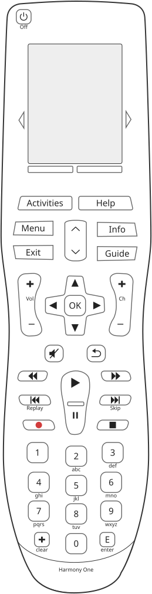

# Harmony One: keys

The One has a keypad below its screen and a touch screen that speaks for itself, plus four touch keys
around the screen that belong to neither cleanly: one strip at each side of the screen turns the page, and
the two keys below it do what the screen above them says. Its drawing,
[`reference/silhouettes/one.svg`](../../silhouettes/one.svg), is generated from
`packages/silhouettes/src/models/one.ts`: the shapes are traced from Logitech's own documentation and the
words read off a photograph.

## Every key on the drawing

<!-- generated:keys -->
44 keys on the drawing `one`, 40 on the keypad, 4 on the touch panel and 0 that the screen speaks for. 34 carry a measured scan code and 4 are left between two candidates by the drawing.

| key | kind | name from | scan code | screen zone | printed on or beside it |
|---|---|---|---|---|---|
| `Number4` | keypad | catalogue | 1 (0x01) |  | 4, ghi |
| `Exit` | keypad | catalogue | 2 (0x02) |  | Exit |
| `VolumeUp` | keypad | catalogue | 3 (0x03) |  |  |
| `VolumeDown` | keypad | catalogue | 4 (0x04) |  |  |
| `Rewind` | keypad | catalogue | 5 (0x05) |  |  |
| `SkipBack` | keypad | catalogue | 6 (0x06) |  | Replay |
| `Record` | keypad | catalogue | 7 (0x07) |  |  |
| `Number1` | keypad | catalogue | 8 (0x08) |  | 1 |
| `VolumeMute` | keypad | catalogue | 9 (0x09) |  |  |
| `Info` | keypad | catalogue | 10 (0x0A) |  | Info |
| `DirectionLeft` | keypad | catalogue | 11 (0x0B) |  |  |
| `NumberPlus` | keypad | catalogue | 12 (0x0C) |  | clear |
| `Number0` | keypad | catalogue | 14 (0x0E) |  | 0 |
| `Number9` | keypad | catalogue | 15 (0x0F) |  | 9, wxyz |
| `Number8` | keypad | catalogue | 16 (0x10) |  | 8, tuv |
| `Number6` | keypad | catalogue | 17 (0x11) |  | 6, mno |
| `Guide` | keypad | catalogue | 18 (0x12) |  | Guide |
| `ChannelUp` | keypad | catalogue | 19 (0x13) |  |  |
| `ChannelDown` | keypad | catalogue | 20 (0x14) |  |  |
| `FastForward` | keypad | catalogue | 21 (0x15) |  |  |
| `SkipForward` | keypad | catalogue | 22 (0x16) |  | Skip |
| `Stop` | keypad | catalogue | 23 (0x17) |  |  |
| `Number3` | keypad | catalogue | 24 (0x18) |  | 3, def |
| `Number5` | keypad | catalogue | 25 (0x19) |  | 5, jkl |
| `Select` | keypad | catalogue | 28 (0x1C) |  | OK |
| `Play` | keypad | catalogue | 30 (0x1E) |  |  |
| `Pause` | keypad | catalogue | 31 (0x1F) |  |  |
| `Number2` | keypad | catalogue | 32 (0x20) |  | 2, abc |
| `DirectionRight` | keypad | catalogue | 33 (0x21) |  |  |
| `PrevChannel` | keypad | catalogue | 35 (0x23) |  |  |
| `Number7` | keypad | catalogue | 39 (0x27) |  | 7, pqrs |
| `Menu` | keypad | catalogue | 40 (0x28) |  | Menu |
| `Activities` | keypad | printed | not measured |  | Activities |
| `DirectionDown` | keypad | catalogue | one of 26 or 29 |  |  |
| `DirectionUp` | keypad | catalogue | one of 27 or 36 |  |  |
| `DownArrow` | keypad | catalogue | one of 26 or 29 |  |  |
| `Enter` | keypad | printed | not measured |  | E, enter |
| `Help` | keypad | printed | not measured |  | Help |
| `Off` | keypad | printed | not measured |  | Off |
| `UpArrow` | keypad | catalogue | one of 27 or 36 |  |  |
| `ScreenPrev` | touch | printed | 46 (0x2E) |  |  |
| `ScreenNext` | touch | printed | 47 (0x2F) |  |  |
| `SoftLeft` | touch | printed | not measured | 1 |  |
| `SoftRight` | touch | printed | not measured | 2 |  |

Generated from `packages/silhouettes/src/models/one.ts` by `make remote-reference-write`. Change the source, not this block.
<!-- /generated -->

## What pressing or holding does

* **Held, a key repeats its command**, by repeating the code's held block[^s127]; on a held volume key the
  repeat is too fast to land on a chosen level[^s127b].
* **A held touch repeats like a held key**[^s337], which corrects an earlier reading that it did
  not[^s127]; [behaviour.md](behaviour.md).
* **No long press**: Logitech's service declares none for this model[^t-long-press].
* **Off held while the battery goes in enters safe mode**, announced in about five seconds[^s190];
  [firmware.md](firmware.md).

## The two keys below the screen, and the page strips

**The two keys below the screen are labelled by the screen**: "Options" and "Devices" on the activity menu,
"Activities" and nothing on the device list, "Activities" (or "Current Activity" while an activity runs) and
"Devices" on a device page[^s275][^s401]. Logitech's manual calls them the function buttons, "dynamic and
select different functions on the remote or the Activity"[^x-one-manual].

**The strips at each side of the screen turn the page**, and a screen of one page leaves both dead while a
screen of several pages leaves them live[^s275][^s293].

## Where the scan codes come from

A key is known to the configuration by a **scan code**, a number the keypad reports; the name a person
reads on the key is not in the configuration at all.

32 keys are named against a scan from a calibration configuration Logitech's service compiled to a known
setup: the code each scan sends was decoded and looked up in the named commands and button maps the same
service states for that setup[^s133]. Logitech's maps name 36 buttons, those 32 plus the four of the two
pairs below, with none left over[^s133].

**Two pairs were left open by the activities and are decided by device maps**: scans 27 and 36 are
`DirectionUp` and `UpArrow`, and 26 and 29 are `DirectionDown` and `DownArrow`, and every activity gives both
members of a pair the same command[^s133]. The device maps decide them, as they did the Harmony
600's[^s323]. The calibration setup's three devices state `DirectionUp` and `DirectionDown` and no arrows,
and their own records bind 27 and 29 and leave 36 and 26 unbound, so 27 is `DirectionUp`, 29
`DirectionDown`, 36 `UpArrow` and 26 `DownArrow`[^s398]. Read on those three devices only. The drawing
still carries the four as candidates, so the table above says "one of".

Off, Activities, Help and Enter carry no scan because no configuration read binds them[^s133].

## How many keys

| count | source |
|---|---|
| 44 on the drawing: 40 keypad keys and 4 touch keys | `one.ts`, which nothing cross checks |
| 40 matrix keys, beside four touch areas on the panel: two flanking the screen and two below it | [^s48][^s125] |

The two agree: 44 in all, 40 of them matrix keys. Both archive sections counted otherwise before they were
corrected in place, the first 42 and the second 44 "besides the panel"[^s48][^s125]. A count over USB
gives nothing on this model, because the keypad shares one sense line, [hardware.md](hardware.md).

## The key table

The configuration's key table holds 52 press codes, scans 1 to 40, 43 to 53 and 55, and this platform
records presses only, where the Harmony 600, 650 and 700 record press, release and repeat[^s17][^s48b].
**That 1 to 40 are the matrix keys, 43 to 53 the touch panel and 55 not a key is a prediction nobody has
tested**[^s48b].

## The touch codes

| codes | what they are |
|---|---|
| 46 and 47 | the strips at each side of the display, the page arrows; no mode page binds them, 778 of 778 over four configurations[^s125][^s275] |
| 48 to 53 | up to six blocks on the screen; which code is which row is **per page**, so a row is recognised by its place and never by its code[^s125][^s275] |
| 43 and 44 | the two touch keys below the screen[^s125] |
| 45 | never in the hit map[^s45] |

Screen keys and keypad keys share no scan code, four of four configurations[^s128]. Where a touch lands
on the screen is [display.md](display.md#where-a-touch-lands-the-hit-map).

## Not checked

* The arrow pairs beyond the calibration setup's three devices, and the drawing, which still carries them
  as candidates[^unchecked].
* The physical key matrix, which no read over USB can reach on this model[^unchecked].
* Which keys give the bootloader's two key codes, `0x0E` and `0x1E`, read in the firmware[^s189].

[^s127]: Read in the firmware. [Section 127](../../../docs/findings.md#s127)
[^s127b]: Measured on a unit. [Section 127](../../../docs/findings.md#s127)
[^s337]: Read in the firmware. [Section 337](../../../docs/findings.md#s337)
[^t-long-press]: Stated by Logitech, by their service. [The test](../../../packages/usb/test/models.test.ts)
[^s190]: Measured on a unit. [Section 190](../../../docs/findings.md#s190)
[^s275]: Measured in configurations. [Section 275](../../../docs/findings.md#s275)
[^s401]: Measured in configurations. [Section 401](../../../docs/findings.md#s401)
[^x-one-manual]: Stated by Logitech, in the manual. [The Harmony One user guide](https://secure.logitech.com/assets/44645/13/harmonyone-user-guide.pdf)
[^s293]: Measured in configurations. [Section 293](../../../docs/findings.md#s293)
[^s133]: Stated by Logitech, by their service. [Section 133](../../../docs/findings.md#s133)
[^s323]: Stated by Logitech, by their service. [Section 323](../../../docs/findings.md#s323)
[^s398]: Measured in configurations. [Section 398](../../../docs/findings.md#s398)
[^s48]: Measured on a unit. [Section 48](../../../docs/findings.md#s48)
[^s125]: Measured in configurations. [Section 125](../../../docs/findings.md#s125)
[^s17]: Measured in configurations. [Section 17](../../../docs/findings.md#s17)
[^s48b]: Measured in configurations. [Section 48](../../../docs/findings.md#s48)
[^s45]: Measured in configurations. [Section 45](../../../docs/findings.md#s45)
[^s128]: Measured in configurations. [Section 128](../../../docs/findings.md#s128)
[^unchecked]: Not checked.
[^s189]: Read in the firmware. [Section 189](../../../docs/findings.md#s189)
